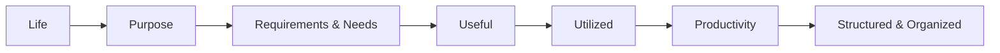

Problem Solving

Core Idea:

Life -> Purpose -> Requirement & Needs -> Useful -> Utilized -> Productivity flow -> Structured and Organized

Audience:

**Beginner:  Solution for any Problem**

**Intermediate: Solution for Specific Requirements**

**Expert: How to architect a Solution**

