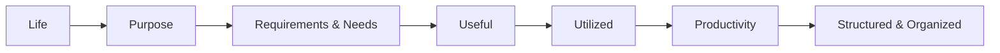

Problem Solving

Core Idea:

Life -> Purpose -> Requirement & Needs -> Useful -> Utilized -> Productivity flow -> Structured and Organized

Audience:

**Beginner:  Solution for any Problem**

**Intermediate: Solution for Specific Requirements**

**Expert: How to architect a Solution**

Not just a problem but a usecase:

Build the code -> Test cases -> security code -> usecases to think

Eg.,:
Usecase to think:

| 1 | Divisibility | Check whether a number is divisible by another number | Payment schedules, periodic billing, mathematical validation |
| 2 | Last digit | Extract the last digit without converting to a string | Number processing, OTP display masking, numeric validation |
| 3 | Leap year | Apply multiple divisibility conditions | Calendar applications, date and time systems |
| 4 | Cyclic event | Find a position in a repeating 7-day cycle | Scheduling systems, recurring jobs, weekly reports |
| 5 | Round-robin server selection | Distribute requests across multiple servers | Load balancers, request distribution |
| 6 | Last two digits | Extract the last two digits | Year extraction, numeric parsing, identifier processing |
| 7 | Count ways | Keep large DP results within a specified modulus | Combinatorics, competitive programming, counting algorithms |
| 8 | Rabin–Karp | Compare rolling hash values during string searching | Text search, plagiarism detection, duplicate substring detection |
| 9 | Hashing | Map a hash value to a valid table index | Python dictionaries, database indexing concepts, cache lookup |
